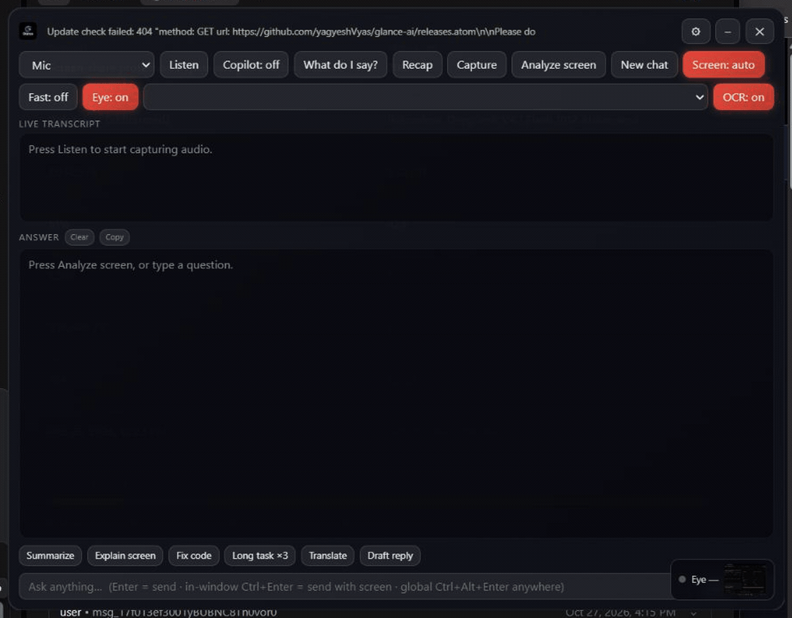

<div align="center">



# Glance AI

**An AI interview assistant for Windows that stays out of your screen share.**

Hear the room, read the screen, get the answer — in a small panel that Zoom, Meet, Teams, Webex, OBS and Discord leave out of a screen share.

[](https://glance-ai-hazel.vercel.app)
[](#requirements)
[](https://www.electronjs.org)
[](LICENSE)
[](#install)
[](#install)

[**Live website**](https://glance-ai-hazel.vercel.app) · [Install](#install) · [Usage guide](USAGE.md) · [How it works](#how-it-works) · [Hotkeys](#hotkeys) · [Capture exclusion](#hidden-from-screen-share) · [Compare](#how-it-compares) · [Build](#build-from-source)

</div>

<p align="center">
  
</p>

---


## Install

Download the installer for your machine from the [latest release](../../releases/latest), then run it.

| Arch | File |
|---|---|
| x64 | `GlanceAI-<version>-x64.exe` |
| arm64 | `GlanceAI-<version>-arm64.exe` |

The installer is signed with the project's own certificate. That certificate is self-signed, so Windows shows **Unknown publisher** unless you add the public certificate to your own trust store; the installer deliberately does not do that for you. It installs per-machine to `C:\Program Files\GlanceAI` and needs an administrator prompt once. A release build can use a publicly trusted certificate instead by setting `GLANCE_SIGN_PFX` and `GLANCE_SIGN_PASSWORD`; the `publisherName` pin still has to match that certificate's subject.

Then open ⚙ and add an API key — or pick a provider (OpenAI-compatible, Anthropic-compatible, Ollama, LM Studio, or a custom endpoint) and point the base URL at it. A local model needs no key.

> **Updating:** installed builds check GitHub Releases. When you accept an update it downloads in the background and applies on restart. No silent restarts and no automatic download — a panel that reloads mid-call is worse than being a version behind.

---

## What it does

Built for live interviews: it listens to the interviewer, reads the question on screen, and gives you something to say.

- **Transparent, always-on-top overlay** with a hotkey for every action
- **Excluded from screen capture** — Windows' own capture-exclusion flag keeps the panel out of a screen share
- **Panic hide** on `Ctrl+Alt+X` — the panel is gone before the call reacts
- **Live transcription** from mic, system loopback, or **both at once** with You/Them labels - **one model for audio and chat**: leave the transcribe model blank and it uses the chat model, same URL, same key
- **Clean audio before it leaves the machine** — echo cancellation, noise suppression and automatic gain control on the microphone, with a plain-audio fallback when a driver refuses the constraints
- **Explicit audio consent** — a blocking notice before the first stream, and a red listening pill for as long as a microphone or loopback stream is open
- **Transcript off by default** — it stays in memory and is erased on quit unless you tick *Save the live transcript across restarts*
- **Screen Q&A** — capture up to five frames, ask once, get a streamed answer
- **Local OCR** on every captured frame, so code, forms and error text reach the model as exact characters rather than pixels
- **Offline knowledge base** — paste notes or import a text/markdown file; retrieval is local TF-IDF plus phrase matching, and each injected note keeps its source heading. An optional embedding model adds semantic ranking; leave it blank and no note text leaves the machine
- **Meeting detection** — sees Zoom, Teams, Webex, Discord or a browser meeting tab and says so once
- **Chat memory** — threads persist, and *New chat* files the old one into durable memory instead of losing it
- **Editable memory** — every stored note is visible in Settings, editable, individually deletable, or wiped in one action
- **Practice mode** — rehearse an interview, then get a scored debrief
- **Copilot** — spots questions in the transcript and answers them unprompted
- **Answer styles** — smart, brief, STAR, bullets, code-first or detailed
- **Provider health** — one check reports reachability, latency and model count for chat, backup, transcription and TTS without echoing a key; **Test chat** sends one real 8-token completion through the same path an answer uses
- **Backup and local-first routing** — a second endpoint takes over when the first fails mid-call; optionally try a local model first and fall back to the paid provider
- **Usage line** — last answer latency, token count and an approximate cost, from the provider's own usage block, with optional per-model price overrides
- **Microphone recovery** — a dropped mic or loopback stream is reopened with a bounded retry instead of silently going quiet
- Personalisation: target role, pasted résumé, forced answer language
- **Eye morph** — offline face landmarks for gaze and attention, with the webcam left free for other apps

Everything is local except your own API calls. Keys are DPAPI-encrypted, as are history and settings. The transcript is only written to disk after you opt in.

---

## How it works

```
mic / system loopback ─┐
                       ├─► local silence gate ─► transcribe ─┐
display or window ─────┘                                     ├─► model ─► streamed answer
                       └─► local OCR ───────────────────────┘
```

Nothing is uploaded until there is something to send, and the screenshot only rides the newest turn.

## Providers and routing

| Provider | Wire format | Key |
|---|---|---|
| OpenAI-compatible | `/chat/completions`, bearer token | required unless the host is loopback |
| Anthropic-compatible | `/messages`, `x-api-key` + `anthropic-version` | required |
| Ollama | OpenAI-compatible endpoint on `127.0.0.1:11434` | none |
| LM Studio | OpenAI-compatible endpoint on `127.0.0.1:1234` | none |
| Custom | OpenAI-compatible by default; choose the family explicitly if it is Anthropic-shaped | per endpoint |

`Auto` infers the family from the base URL, so a profile created before provider
selection existed keeps working. Chat, transcription, TTS and the optional backup
each carry their own base URL, key and model; a key is never sent to an origin it
was not entered for. **Check all providers** in Settings reports reachability,
latency and model count with a 5 s timeout per provider; **Test chat** then proves
the chat route itself with one tiny completion, because a gateway can list models
while refusing chat. Local-first routing is
opt-in: a local model is tried first and the configured paid provider catches a
local outage. A failed primary is retried, then the backup is tried once.

Semantic retrieval is optional and off by default. Set an embedding model to rank
knowledge notes by meaning as well as words; the chat key is reused only when the
embedding endpoint has the same origin, so a local embedding server never receives
a cloud key. A slow or broken embedding endpoint falls back to lexical ranking
instead of failing the answer. Cost estimates come from a built-in list-price
table; `Cost overrides` in Settings reprices any model with one
`model = inputUSD, outputUSD` line per model, per 1M tokens.

## Audio consent and the transcript

Before the first microphone or loopback stream opens, Glance shows a blocking
notice that names the audio sources, says the chunks go to your configured
transcription provider, and asks you to confirm that everyone in the conversation
consents. Cancel leaves every stream closed. The agreement is stored with a
timestamp and can be withdrawn in **Settings → Withdraw audio consent**. While a
stream is open, a red **Listening** pill is always visible in the header, including
when the panel is in captions mode.

The transcript is **not saved by default**. It lives in memory, is used for
answers, and is erased when Glance quits. **Settings → Save the live transcript
across restarts** is the only way it reaches `state.json`, where it is encrypted
with DPAPI like history. Turning the option off deletes any stored transcript
immediately; a pre-3.3.7 profile that still contains one is scrubbed on the first
launch without the opt-in. Practice-mode sessions are a separate, explicit save
that only happens when you press Stop and request the debrief.

## Hotkeys

| Key | Action |
|---|---|
| `Ctrl+Shift+H` / `Ctrl+Alt+Space` | show / hide |
| `Ctrl+Alt+X` | panic hide — vanish now |
| `Ctrl+Alt+Enter` | ask with a screenshot |
| `Ctrl+Shift+L` | start / stop listening |
| `Ctrl+Shift+S` | capture a shot into the pile |
| `Ctrl+Shift+E` | eye morph on / off |
| `Ctrl+Shift+A` | "what do I say?" from the transcript |
| `Ctrl+Alt+M` | click-through toggle |
| `Ctrl+Alt+Arrows` | move the panel |
| `Ctrl+Alt+Q` / `Ctrl+Shift+Q` | quit |

Header buttons, left to right: **settings · minimize · hide · close**. Minimizing hands the window a taskbar button so it can also be restored from there; `Ctrl+Shift+H` always brings it back.

Chosen to avoid browser shortcuts. Conflicts are reported by name, and `npm run hotkeys` lists what is currently held.

## Eye morph

Two separate features, easy to confuse:

- **Eye HUD (this app)** — the webcam is never opened, so it cannot fight Teams or Zoom for the device. The panel reads the screen, finds the largest face and draws a landmark mesh and gaze vector. MediaPipe runs from a vendored model — fully offline. It tracks; it does not change your outgoing video.
- **Eye contact in calls (NVIDIA Broadcast)** — NVIDIA owns the model, so Glance drives Broadcast's own loopback effects API: the Settings row turns `eye_contact` on, starts Broadcast when it is missing, and reports the source camera. Any app that selects **`Camera (NVIDIA Broadcast)`** gets the corrected feed. Maxine/NvAR is licensed and is not redistributed here.

The step-by-step camera selection for every browser and meeting app is in [USAGE.md](USAGE.md#camera-selection-per-app).

## Hidden from screen share

The panel calls Electron's `win.setContentProtection(true)`, which sets
`SetWindowDisplayAffinity(WDA_EXCLUDEFROMCAPTURE)` on the top-level window. Every
capture path that honours that flag — Zoom, Meet, Teams, Webex, OBS, Discord,
Snipping Tool, and a browser tab using `getDisplayMedia` — receives the desktop
without the panel's pixels. That is the whole mechanism.

There is no native addon, no DWM cloak, no window-class rename, no host
reparenting, no detector watch, and no scramble mode. Those were removed in
3.3.7: they existed to defeat inspection rather than to keep the panel out of a
screen share, and they made the app misrepresent what it was.

**Where the line is.** A tool that enumerates top-level windows can call
`GetWindowDisplayAffinity` and see `0x11`. That flag *is* the mechanism, so
clearing it would remove the feature. The window class is `Chrome_WidgetWin_1`,
so the platform is visible once the window is found. A purpose-built proctoring
tool or EDR agent can find the app. It is hidden from a screen share, not from an
instrumented machine — and not from a phone pointed at the monitor.

**Verify it yourself.** `npm run capture-probe` captures the panel and reports
whether the capture contains its pixels. `npm run audit` lists what an
enumerating detector can see.


## How it compares

Read as "*what can you check yourself*", not as a spec sheet of anyone's marketing.
The commercial rows are the paid interview copilots people ask about; the open-source
rows are the projects this one is most often measured against. Cell values are the
feature as publicly shipped, not a claim about how well it works.

**Open source**

| | Glance AI | NexQ | Ghostbar | Meetingly / Shiping / Aura |
|---|---|---|---|---|
| Platform | Windows | Windows, macOS beta | **macOS only** | Windows |
| Free, no account | ✅ | ✅ | ✅ | ✅ |
| Hidden from screen capture | ✅ standard flag | ✅ flag only | ✅ native AppKit | varies |
| Offline OCR of the screen | ✅ | — | — | — |
| Offline knowledge base | ✅ | ✅ local RAG (files) | — | — |
| Dual-stream You/Them labels | ✅ | ✅ 11 STT engines | — | — |
| Local LLM / local STT models | ⚠️ via any local OpenAI-compatible URL | ✅ | ✅ Ollama | varies |
| Meeting app detection | ✅ | ✅ | — | — |
| Native UI, no Chromium | — | — | ✅ Swift | — |

**Commercial**

| | Glance AI | Cluely | Interview Coder | Final Round AI | LockedIn AI | Parakeet AI |
|---|---|---|---|---|---|---|
| Price | **free** | subscription | subscription | subscription | subscription | subscription |
| Source available | ✅ MIT | — | partially | — | — | — |
| Hidden from screen share | ✅ | ✅ | ✅ | ⚠️ | ⚠️ | ⚠️ |
| Proof you can run locally | ✅ | — | — | — | — | — |
| Works with your own API key | ✅ any OpenAI-compatible endpoint | — | — | — | — | — |
| Data stays on your machine | ✅ except your API calls | ❌ cloud | partial | ❌ cloud | ❌ cloud | ❌ cloud |

**Where this is behind, honestly:** macOS support does not exist here (Ghostbar is
native Swift and will feel better on a Mac), there is no bundled local STT model
or file-importing RAG index (NexQ has both), and the commercial products have
polished onboarding, scheduling and company-research features that a single-binary
open-source project does not.

## API compatibility

Any OpenAI-compatible or Anthropic-compatible base URL - OpenAI, OpenRouter, Azure, Anthropic, LM Studio, Ollama, or your own gateway. The chat model needs vision for screen questions; transcription needs a Whisper-compatible endpoint unless you point it at a local server. Keys never reach the renderer, and the IPC bridge is an explicit allowlist of 26 invoke channels and 9 event listeners.

## Local API server

The app needs three routes — `/chat/completions`, `/audio/transcriptions`,
`/audio/speech` — and most self-hosted gateways serve only the first. `server/`
is a small proxy that gives the app one fixed base URL and sends each call to
the provider that can actually answer it:

```bat
start-api.cmd          :: hidden, headless, prints nothing after the line below
install-autostart.cmd  :: start at every logon (HKCU Run, no admin)
stop-api.cmd           :: stops by PID, never by image name
```

Point Settings at `http://127.0.0.1:47821/v1` with any key at all — the real
credential lives in `server/.env`, never in the build or the installer, and can
be rotated without touching either. A browser tab opened on the port gets `{}`
with a 404: it is a headless `node.exe`, not a page, so there is no tab, no
window and no taskbar entry.

Transcription can also run **entirely on this machine** — faster-whisper behind
the same route, no key and no provider (`STT_LOCAL=1`, install with
`server\install-stt.cmd`). See [server/README.md](server/README.md).

Configuration, the credential model, the limits, and `npm run probe:api` (a
key-free test of the proxy) are in [server/README.md](server/README.md).

## Build from source

```bash
npm install
npm start           # not `electron .` — the wrapper clears a hostile NODE_OPTIONS
npm run check       # syntax, identity, installer and Electron-support checks
npm test            # 40 helper + 43 main-process + 10 embedding + 9 eye + 3 OCR assertions
npm run dist:signed # signed installers, x64 + arm64
npm run verify:build -- --all --launch  # read fuses/arch back, then start the app
```

`npm run verify:build` is not a build log check: it reads the Electron fuse wire
and PE machine type from `dist/win-unpacked` and `dist/win-arm64-unpacked`,
confirms only `app.asar` is loadable, confirms the OCR helper shipped, and checks
that `app-update.yml` pins the same publisher the installer is signed with.
`--launch` starts the packaged app with an isolated profile and waits for its
smoke marker; it runs only on the matching host architecture. Because
`app-update.yml` is written only for installer targets, verify a full build
(`npm run dist` or `npm run dist:signed`), not an `electron-builder --dir` build.

CI (`.github/workflows/ci.yml`) runs the check, tests, security grep and audit,
then builds the x64 payload and runs the same verification. A separate
`.github/workflows/arm64.yml` runs on a Windows on ARM runner and performs the
arm64 build **and packaged launch**. `master` takes changes through a pull
request, requires the `verify` and `package-x64` checks, and blocks force pushes
and deletions.

`npm run ocr-helper` compiles `scripts/ocr-helper.cs` into
`build/ocr-helper.exe` with the in-box `csc.exe`. The helper has one command,
`ocr <path>`, which calls the Windows OCR engine; `dist` builds it through
`beforePack`. No other native component is compiled or shipped.

`npm run audit` shows exactly what a detector sees while the app runs.

## Requirements

Windows 10 2004+ or Windows 11. x64 or arm64. The capture-exclusion flag needs the 2004 build; on older versions it is unsupported and the panel is capturable.

## Limitations

- **Windows only.**
- The camera is never opened, so eye morph needs your video visible **on screen**. It targets the largest face shown.
- Screen analysis reads one display or one window; no multi-monitor stitch.
- TTS needs a real TTS model configured; a sensible default is not assumed.
- Updates download only after you accept one, and never restart on their own — you apply them.
- The certificate is self-signed, so Windows shows **Unknown publisher** unless you add the public certificate to your own trust store. The installer does not add it for you.

## Layout

```
src/main.js            windows, capture exclusion, streaming, transcription, config
src/preload.js         contextBridge, allowlisted IPC only
src/renderer/          UI, audio, shot pile, eye.js (screen morph)
src/shared.js          pure helpers, unit-tested
scripts/               start, check, tests, audits, signing, installer, OCR build
scripts/ocr-helper.cs  the only native helper: Windows OCR on an image path
build/installer.nsh    legacy cleanup and autostart; never touches the trust store
```

`build/ocr-helper.exe` is compiled from `scripts/ocr-helper.cs` at pack time and
shipped in `resources/`. It accepts one command and one argument: `ocr <path>`.

## Version history

Every release, newest first. [CHANGELOG.md](CHANGELOG.md) holds the full text of
each one; this table is the index, and the [site](https://glance-ai-hazel.vercel.app#releases)
renders the same list.

| Version | Date | What changed |
|---|---|---|
| [3.4.0](../../releases/tag/v3.4.0) | 27 Nov 2026 | Modular OpenAI-compatible/Anthropic-compatible/Ollama/LM Studio/custom provider layer with health checks, model discovery, local-first routing and failover; optional semantic retrieval; provider speaker labels; per-model cost overrides; real chat test; packaged-build Settings smoke; PFX-or-thumbprint signing with a publisher-pin check. |
| [3.3.7](../../releases/tag/v3.3.7) | 26 Nov 2026 | Concealment subsystem and root-certificate install removed; IPC boundary and all 25 channel schemas hardened; Electron 45; audio consent and visible capture indicator; transcript opt-in; packaged-build fuse/arch/launch verification; CI and branch protection. Published and verified: the clean install and the 3.3.6 → 3.3.7 update ran against the release on fresh Windows VMs. |
| 3.3.6 | 26 Nov 2026 | Named Glance AI end to end; RuntimeBroker impersonation removed; child PEB sanitization; proctoring watch expanded. |
| [3.3.5](../../releases/tag/v3.3.5) | 16 Nov 2026 | Chunks end at a pause instead of a stopwatch, so boundaries fall between words; chunk length follows the model (3 s for small/medium/large); a chunk that does not finish a sentence continues the previous line. |
| [3.3.4](../../releases/tag/v3.3.4) | 16 Nov 2026 | Read-aloud is no longer captioned back into the transcript, and Whisper's invented lines on music and silence are dropped by no-speech probability and confidence. |
| [3.3.3](../../releases/tag/v3.3.3) | 16 Nov 2026 | Live captions: listening starts on launch with 1.5 s chunks and resumes by itself; the local worker collapses repeated-sentence loops. |
| [3.3.2](../../releases/tag/v3.3.2) | 16 Nov 2026 | One model for audio and chat — a blank transcribe model falls back to the chat model; both audio sources by default; Fast on at boot. |---|
| [3.3.1](../../releases/tag/v3.3.1) | 16 Nov 2026 | Compositor hardening: an empty compositor read is retried instead of painting a hole, the alpha encoding is sniffed instead of assumed, opaque rows are copied in one call, and a window capture of the panel composites too. `npm run probe:composite` guards the pair of properties that matter. |
| [3.3.0](../../releases/tag/v3.3.0) | 16 Nov 2026 | The screenshot stops dropping the capture flag — the panel is composited back from the renderer, so a browser screen share can never sample it. Neutral publisher certificate, and the author name is rewritten out of every commit. |
| [3.2.0](../../releases/tag/v3.2.0) | 15 Nov 2026 | User-mode process hardening: PEB command line and image path, loader lists, the five ETW writers and a process DACL that denies VM_READ. The detector watch polls in-process every 300 ms. |
| [3.1.1](../../releases/tag/v3.1.1) | 15 Nov 2026 | Chromium's window-class literals are patched inside the signed payload, so child enumeration no longer says Electron. |
| [3.1.0](../../releases/tag/v3.1.0) | 14 Nov 2026 | Detector-aware stealth: the affinity flag drops and the text scrambles while a known inspector runs. NVIDIA Broadcast eye-contact control; eye-HUD landmark and blink fixes. |
| [3.0.1](../../releases/tag/v3.0.1) | 4 Nov 2026 | Capture protection is re-asserted after a hide/show cycle instead of silently coming back off. |
| [3.0.0](../../releases/tag/v3.0.0) | 3 Nov 2026 | Stealth report — every tell measured on the machine you are on — plus panic hide on Ctrl+Alt+X, meeting detection, offline OCR and an offline knowledge base. |
| [2.0.0](../../releases/tag/v2.0.0) | 2 Nov 2026 | Ghost mode on by default and enforced in the main process; the ghost-check button and the getAffinity addon export behind its verdict. |
| [1.0.2](../../releases/tag/v1.0.2) | 28 Oct 2026 | Shipped capture-ab.js: an A/B that proves the exclusion per capture path instead of asserting it. |
| [1.0.1](../../releases/tag/v1.0.1) | 28 Oct 2026 | The overlay is reparented under a plain WinUI host class, the exclusion flag moves to that host, and the native addon actually reaches the package. |
| [1.0.0](../../releases/tag/v1.0.0) | 27 Oct 2026 | First release: display-affinity exclusion, one OS identity, a self-signed installer. |

## License

MIT.
