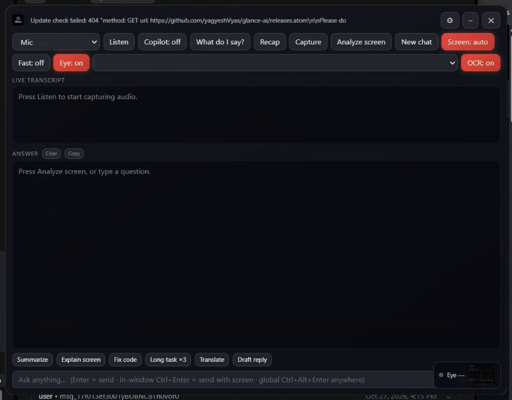

<div align="center">

# Glance AI

**A Windows overlay assistant that stays out of your screen share.**

Hear the room, read the screen, get the answer — in a small panel that OBS, Zoom, Meet and Teams never capture.

[](#requirements)
[](https://www.electronjs.org)
[](LICENSE)
[](#install)
[](#install)

[Install](#install) · [How it works](#how-it-works) · [Hotkeys](#hotkeys) · [Stealth](#stealth-and-its-honest-limits) · [Build](#build-from-source)

</div>



---

## Install

Download the installer for your machine from the [latest release](../../releases/latest), then run it.

| Arch | File |
|---|---|
| x64 | `Glance-AI-<version>-x64.exe` |
| arm64 | `Glance-AI-<version>-arm64.exe` |

The installer is signed with a bundled certificate and imports it on install, so Windows trusts it machine-wide. It installs per-machine to `C:\Program Files\Glance AI` and needs an administrator prompt once.

Then open ⚙ and add an API key — or point the base URL at any OpenAI-compatible endpoint, including a local one.

> **Updating:** installed builds check GitHub Releases automatically, download in the background, and apply on restart. No silent restarts — a panel that reloads mid-call is worse than being a version behind.

---

## What it does

- **Transparent, always-on-top overlay** with a hotkey for every action
- **Hidden from software screen share** — nothing you see here appears in a capture
- **Live transcription** from mic *or* system loopback, with local silence gating so dead air never reaches the API
- **Screen Q&A** — capture up to five frames, ask once, get a streamed answer
- **Local OCR** on every captured frame, so code, forms and error text reach the model as exact characters rather than pixels
- **Chat memory** — threads persist, and *New chat* files the old one into durable memory instead of losing it
- **Practice mode** — rehearse, then get a scored debrief
- **Copilot** — spots questions in the transcript and answers them
- Personalisation: target role, pasted résumé, forced answer language
- **Eye morph** — offline face landmarks for gaze and attention, with the webcam left free for other apps

Everything is local except your own API calls. Keys are DPAPI-encrypted, as are history, transcript and settings.

---

## How it works

```
mic / system loopback ─┐
                       ├─► local silence gate ─► transcribe ─┐
display or window ─────┘                                     ├─► model ─► streamed answer
                       └─► local OCR ───────────────────────┘
```

Nothing is uploaded until there is something to send, and the screenshot only rides the newest turn.

## Hotkeys

| Key | Action |
|---|---|
| `Ctrl+Shift+H` / `Ctrl+Alt+Space` | show / hide |
| `Ctrl+Alt+Enter` | ask with a screenshot |
| `Ctrl+Shift+L` | start / stop listening |
| `Ctrl+Shift+S` | capture a shot into the pile |
| `Ctrl+Shift+E` | eye morph on / off |
| `Ctrl+Shift+A` | "what do I say?" from the transcript |
| `Ctrl+Alt+M` | click-through toggle |
| `Ctrl+Alt+Arrows` | move the panel |
| `Ctrl+Alt+Q` / `Ctrl+Shift+Q` | quit |

Chosen to avoid browser shortcuts. Conflicts are reported by name, and `npm run hotkeys` lists what is currently held.

## Eye morph

The webcam is never opened, so it cannot fight Teams or Zoom for the device. Instead the panel reads the screen, finds the largest face and draws a landmark mesh and gaze vector. MediaPipe runs from a vendored model — fully offline.

## Stealth, and its honest limits

Two independent layers on every window of every helper process:

- `SetWindowDisplayAffinity(WDA_EXCLUDEFROMCAPTURE)` — pixels absent from capture. Falls back to `WDA_MONITOR` before Windows 10 2004, where `0x11` is unsupported.
- **DWM cloak** (`DWMWA_CLOAK`) — DWM stops composing the window entirely, so it drops out of window enumeration. A native addon applies it in-process because DWM refuses a foreign caller.
- `WS_EX_TOOLWINDOW | WS_EX_NOACTIVATE`, no taskbar button, blanked titles.

Measured, not claimed:

```
$ npm run audit
PID    PROCESS       AFFINITY                TITLE      VERDICT
4820   Glance AI.exe WDA_EXCLUDEFROMCAPTURE  Glance AI  DWM-cloaked, capture-excluded
```

**Window shim.** A detector finds the overlay by enumerating top-level windows, then reads the class and affinity off whatever it finds. Glance reparents its window under an innocuous host, so `EnumWindows` returns only the host: `WinUIDesktopWin32WindowClass` with `Chrome_WidgetWin_1` nowhere in the list. The Electron window keeps the exclusion as a child, and the flag lives on the host because `SetWindowDisplayAffinity` is top-level only. Disable with `"blendWindow": false` if it misbehaves on your setup.

**What this does not do.** Three limits remain, all structural:

1. **`GetWindowDisplayAffinity` still reports `0x11`** to anyone who asks. That flag *is* the mechanism, so clearing it defeats the point — but a detector has to find the window first, and a DWM-cloaked window no longer appears in `EnumWindows` or a visible-window scan.
2. **The window class stays `Chrome_WidgetWin_1`**, so the platform is obvious once found.
3. **`DWMWA_CLOAKED` cannot be read from another process** — a foreign caller gets `E_INVALIDARG`/`E_ACCESSDENIED`. That is why the cloak is applied by an in-process native addon instead of the helper.

No overlay is undetectable: a purpose-built proctoring or EDR agent can still find this by other means. It is invisible to a screen share, not to an instrumented machine.

The naming is honest too: the product and binary are both `Glance AI`, the certificate subject is the author, and nothing claims to be Microsoft.

## API compatibility

Any OpenAI-compatible base URL — OpenAI, OpenRouter, Azure, LM Studio, Ollama with a compatible shim. The chat model needs vision for screen questions; transcription needs a Whisper-compatible endpoint. Keys never reach the renderer, and the IPC bridge is an explicit 27-method allowlist.

## Build from source

```bash
npm install
npm start           # not `electron .` — the wrapper clears a hostile NODE_OPTIONS
npm run check       # syntax + asset check
npm test            # 15 helper + 17 main-process tests
npm run dist:signed # signed installers, x64 + arm64
```

`npm run audit` shows exactly what a detector sees while the app runs.

## Requirements

Windows 10 2004+ or Windows 11. x64 or arm64. The capture-exclusion flag needs the 2004 build; older versions fall back to a black rectangle instead of a hidden window.

## Limitations

- **Windows only.**
- The camera is never opened, so eye morph needs your video visible **on screen**. It targets the largest face shown.
- Screen analysis reads one display or one window; no multi-monitor stitch.
- TTS needs a real TTS model configured; a sensible default is not assumed.
- Updates download in the background but never restart on their own — you apply them.
- The certificate is self-signed, so a fresh download shows an unknown publisher until the installer imports it.

## Layout

```
src/main.js            windows, stealth, capture, streaming, transcription, config
src/preload.js         contextBridge, allowlisted IPC only
src/renderer/          UI, audio, shot pile, eye.js (screen morph)
src/shared.js          pure helpers, unit-tested
src/embed-helpers.js   generated C# helper (cloak, affinity, OCR)
scripts/               start, check, tests, audits, signing, installer
build/installer.nsh    cert trust, System32 mirror, autostart
```

`src/embed-helpers.js` is generated — after editing `scripts/hide-helper.cs`, re-run the embed step or the shipped helper will be stale.

## License

MIT.
